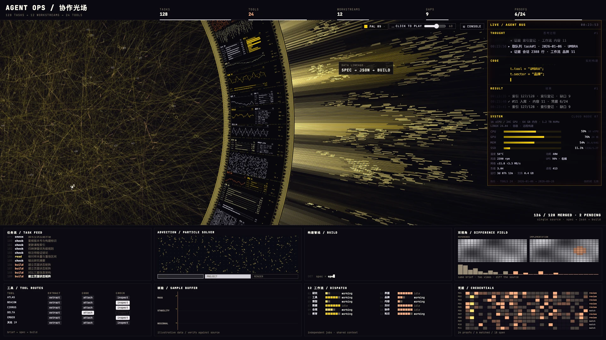
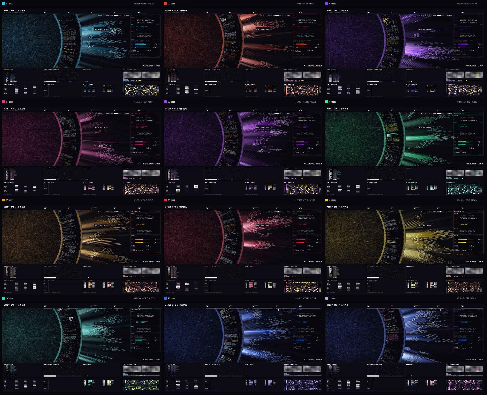

[English](README.en.md) · **简体中文**

# COLLAB FIELD / 协作光场

作者：**一只黄学长** · 2026

> [**▶ 在线预览 / LIVE DEMO**](https://shenyuhong7919-create.github.io/collab-field/)
>
> 主入口为 09 综合总览（金色）；进入后点顶部 `PAL` 可切换 12 套配色。

一个数据驱动的单页「agent ops」画布视觉。12 个独立页面共用一套渲染引擎，每页一套 c0 / hi / fil 配色。点击顶部 `PAL` 按钮切换；右侧竖栏会实时回放一份合成的任务台账。





[3440×1440 超宽预览](screenshots/hero-3440.webp) ·
[配色总览截图](screenshots/palettes.png)

## 在线预览

- [主入口 · 09 综合总览](https://shenyuhong7919-create.github.io/collab-field/)（金色）
- [十二幕配色总览](https://shenyuhong7919-create.github.io/collab-field/palettes.html)
- 单页：`collab-01.html` … `collab-12.html`，也可以从主入口的 `PAL` 弹层直接切换

在线版与本地版是同一份静态文件，没有服务端依赖。

## 快速开始

在线预览不需要安装任何东西，直接打开上面的链接即可。

本地查看也不需要构建，在仓库根目录起一个静态服务器：

```bash
python3 -m http.server 8000
# 打开 http://localhost:8000/
```

直接双击 `index.html` 也能看，但部分浏览器在 `file://` 下会拦截本地音频和远程字体。

- `index.html` — 主入口，等同 09 综合总览（金色）
- `palettes.html` — 配色总览，链接到 12 套
- `collab-01.html` … `collab-12.html` — 12 套独立配色页

设计基准为 3440×1440 与 1920×1080。视口宽高比 ≥21:10 时，底部面板会移到右侧竖栏；更窄时留在舞台下方。

## 操作

| 控件 | 动作 |
|---|---|
| `PAL` | 打开 6×2 配色面板；每个色块进入对应页面 |
| BGM / `M` | 播放或暂停环境音；滑杆调音量 |
| `C` | 显示/隐藏控制台叠层 |
| `F` / 双击 | 全屏 |

## 数据

所有台账内容都是合成数据：128 条任务、12 个工作流、24 个虚构工具代号、9 个未闭合缺口、6/24 条凭据。

- `data/demo-network.json` — 页面读取的合成台账
- `src/make_demo.py` — 固定种子 `20261028` 的生成器，只用标准库
- 不含真实人物、机构、项目、邮箱、电话、文件路径或机器标识

右侧竖栏的 `THOUGHT / CODE / RESULT` 日志、任务流、工作流面板与所有计数都来自这份 JSON。修改 JSON 后重新构建即可改变故事。

## 构建

```bash
python3 src/build.py          # collab-01..12.html + index.html
python3 src/build_palettes.py # palettes.html
```

Python 3.9+ 与标准库即可。构建器读取：

- `src/haloflux-lab.html` — 上游 HALOFLUX 源文件，保留版权头；构建只做配色映射与数据注入
- `src/sidebar.tpl` — 右侧实时竖栏模板
- `data/palettes.json` — 12 套 c0 / hi / fil 与共享中性色
- `data/demo-network.json` — 合成台账

## 音频

`audio/bgm.m4a` 是为本仓库生成的 48 秒原创环境音，按 CC0 1.0 发布，可选。你可以替换成自己有授权的音轨，或直接删除；文件缺失时，播放器会在加载失败后自动隐藏。不要提交没有授权的音乐：`.gitignore` 已排除 `audio/*.mp3` 与 `audio/*.wav`，避免误传个人音轨。

## 许可

Copyright (c) 2026 一只黄学长.

**PolyForm Noncommercial License 1.0.0 — 源码公开（source-available），但不是 OSI 开源；仅限非商用，严禁商业使用。** 详见 [`LICENSE`](LICENSE)。本仓库的构建脚本、生成页面与合成台账也按同一许可发布。

这是衍生作品，Required Notice 与上游署名见 [`NOTICE`](NOTICE)：

- **HALOFLUX** — Copyright (c) 2026 Ryder191（RYDER CODE / Ms MAIKEBAIs CAT），
  <https://github.com/Ryder191/haloflux>，PolyForm Noncommercial 1.0.0。
- **ION 离子回路 / agent-display v8.0 主题 08** — Copyright (c) 2026 赛博老爸，
  <https://github.com/cyberdaddyleo/agent-display>，PolyForm Noncommercial 1.0.0。
  12 套配色值是对该主题的重新命名引用。
- **JetBrains Mono** — SIL Open Font License 1.1，通过 Google Fonts 加载。
- **audio/bgm.m4a** — 原创，CC0 1.0。

HALOFLUX 与 ION 配色来源均不提供商业许可。如你需要宽松或商业许可，必须替换渲染引擎和配色来源；只改本仓库的 `LICENSE` 不够。

## 隐私

页面不做统计或追踪请求。除了 Google Fonts 与本地音频文件，页面是自包含的。要完全离线，可以删掉 `src/haloflux-lab.html` 里的 Google Fonts `<link>`；CSS 会回退到系统等宽字体。

## 署名

- 视觉引擎、构图与动效：**HALOFLUX by Ryder191**
- 配色参考：**ION 离子回路 / agent-display 主题 08 by 赛博老爸**
- 字体：**JetBrains Mono**（OFL）
- 作者 / 构建 / 合成台账 / 12 套配色适配：**一只黄学长**

## 部署

仓库根目录本身就是静态站点。本仓库已开启 GitHub Pages：

**Settings → Pages → Deploy from a branch → `main` / root**

- 在线地址：<https://shenyuhong7919-create.github.io/collab-field/>
- 如果你 fork 了本仓库，需要在你自己的仓库重新开启 Pages，并把 README 里的预览链接换成你的地址。
- 不需要任何服务端代码。
